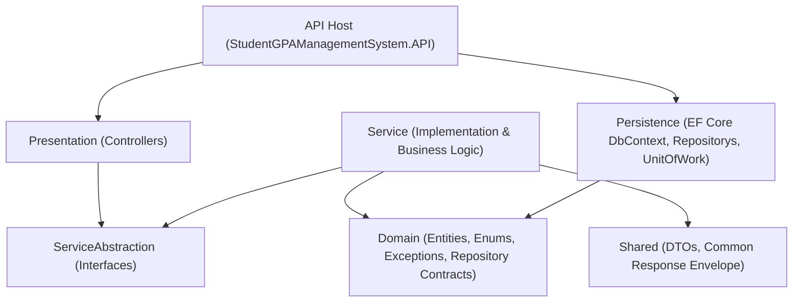

# Student GPA Management System — Backend API & Specification

A robust web-based **Student GPA Management System** developed with **ASP.NET Core (.NET 10)**, **Entity Framework Core 10**, and **SQL Server**, structured using **Clean Architecture**.

The system manages students, courses, semesters, and course enrollments, enforces academic registration rules (including a strict 18-credit-hour semester limit), records numeric scores and special academic statuses (`ABS`, `W`, `I`), resolves letter grades from a database-driven grading scale, and computes Semester and Cumulative GPA on demand with decimal precision.

---

## Table of Contents

1. [Tech Stack](#1-tech-stack)
2. [Clean Architecture & Layers](#2-clean-architecture--layers)
3. [Prerequisites](#3-prerequisites)
4. [Configuration](#4-configuration)
5. [Running the Backend](#5-running-the-backend)
6. [Frontend Overview & Integration](#6-frontend-overview--integration)
7. [Running the Unit Tests](#7-running-the-unit-tests)
8. [Seeded Data & Verification Benchmark (STU001)](#8-seeded-data--verification-benchmark-stu001)
9. [Business Rules Specification](#9-business-rules-specification)
10. [API Endpoints Reference](#10-api-endpoints-reference)
11. [Standard API Response Envelope](#11-standard-api-response-envelope)
12. [Key Design Decisions](#12-key-design-decisions)
13. [Future Enhancements](#13-future-enhancements)

---

## 1. Tech Stack

- **Framework:** ASP.NET Core Web API (.NET 10)
- **Database:** Microsoft SQL Server (LocalDB, Express, or Docker container)
- **ORM:** Entity Framework Core 10 (`Microsoft.EntityFrameworkCore.SqlServer`)
- **Testing:** xUnit 2.9, SQLite In-Memory (`Microsoft.EntityFrameworkCore.Sqlite`, `Microsoft.Data.Sqlite`), and SQL Server Integration Testing
- **Mapping:** AutoMapper (`AutoMapper` package) — *Note on Licensing: AutoMapper transitioned to a commercial dual-license model in v14+. For commercial enterprise compliance, zero-dependency alternatives such as Mapster or hand-crafted mapping extensions can be used.*
- **Validation:** `System.ComponentModel.DataAnnotations` attribute validation combined with application-level business guards in services
- **API Documentation:** Swagger / OpenAPI (Swashbuckle)
- **CORS:** Configured with `AllowAll` policy for local development

---

## 2. Clean Architecture & Layers

The solution enforces separation of concerns across clean architecture layers:



> **Note on Project References:** `Persistence.csproj` and `Presentation.csproj` historically contain `<ProjectReference>` tags pointing to `Service.csproj`. However, inspection confirms 0 types from `Service` are consumed in either project (`Presentation` depends strictly on `ServiceAbstraction`, and `Persistence` on `Domain`). These references are redundant legacy entries that can safely be removed.

### Folder Tree

```
D:/My Job/
├── Back-End/
│   └── StudentGPAManagementSystem/
│       ├── Core/
│       │   ├── Domain/Domain/
│       │   │   ├── Contracts/             # IGenericRepository<T,TKey>, IUnitOfWork
│       │   │   ├── Enums/                 # EnrollmentStatus (Normal=1, Absent=2, Withdrawn=3, Incomplete=4)
│       │   │   ├── Exceptions/            # BadRequestException, BusinessRuleException, ConflictException, NotFoundException
│       │   │   └── Models/                # Student, Course, Semester, Enrollment, GradingScale, BaseEntity
│       │   ├── Service/Service/
│       │   │   ├── MappingProfiles/       # AutoMapper profiles (Student, Course, Semester, Enrollment, GradingScale)
│       │   │   ├── StudentService.cs
│       │   │   ├── CourseService.cs
│       │   │   ├── SemesterService.cs
│       │   │   ├── EnrollmentService.cs
│       │   │   ├── GradingScaleService.cs
│       │   │   ├── GpaCalculatorService.cs
│       │   │   ├── DashboardService.cs    # Single aggregated dashboard analytics service
│       │   │   └── ServiceManager.cs
│       │   └── ServiceAbstraction/ServiceAbstraction/
│       │       └── IStudentService, ICourseService, ISemesterService,
│       │           IEnrollmentService, IGradingScaleService, IGpaCalculatorService, IDashboardService, IServiceManager
│       ├── Infrastructure/
│       │   ├── Persistence/
│       │   │   ├── Data/                  # StudentGpaDbContext, DbInitializer, EF Configurations
│       │   │   ├── Migrations/            # EF Core SQL Server migrations
│       │   │   └── Repositorys/           # GenericRepository<TEntity, TKey>, UnitOfWork
│       │   └── Presentation/
│       │       └── Controllers/           # BaseApiController, StudentsController, CoursesController,
│       │                                  # SemestersController, EnrollmentsController, GradingScalesController, DashboardController
│       ├── Shared/
│       │   ├── Common/                    # Response<T>, ApiResponse<T>, ValidationErrorDetail
│       │   ├── Dto/                       # DTOs segregated per CRUD entity & Transcripts & Dashboard
│       │   └── ErrorModels/
│       ├── StudentGPAManagementSystem.API/
│       │   ├── Extensions/                # Dependency injection & pipeline configurations
│       │   ├── MiddeelWare/               # GlobalErrorHandlingMiddleWare (unified error envelope)
│       │   ├── Program.cs
│       │   └── appsettings.json
│       ├── Tests/
│       │   └── StudentGPAManagementSystem.Tests/
│       │       ├── Courses/               # CourseService tests
│       │       ├── Dashboard/             # DashboardService analytics & aggregation tests
│       │       ├── Enrollments/           # 18-hour limit, snapshots, concurrency & status tests
│       │       ├── ErrorHandling/         # GlobalErrorHandlingMiddleWare envelope tests
│       │       ├── Gpa/                   # GPA calculation & precision tests
│       │       ├── Grading/               # Database-driven grading scale resolution tests
│       │       ├── Semesters/             # Semester validation & date tests
│       │       ├── Students/              # Student uniqueness & delete guard tests
│       │       └── TestDbContextHelper.cs # SQLite in-memory setup & RowVersion handler
│       └── StudentGPAManagementSystem.API.slnx
└── Front-End/
    └── student-gpa-management-system/     # Next.js 14 client (React, TypeScript, Tailwind CSS)
        ├── app/                           # App Router routes and layouts
        ├── components/                    # Feature views (Overview, Students, Courses, Semesters, Enrollments, Transcript)
        ├── services/api/                  # Typed API clients for backend endpoints
        └── types/                         # Shared TypeScript API contracts
```

---

## 3. Prerequisites

- [.NET 10 SDK](https://dotnet.microsoft.com/download)
- Microsoft SQL Server (2019+), SQL Server Express, or Docker container
- Optional Docker command to run SQL Server locally:
  ```bash
  docker run -e "ACCEPT_EULA=Y" -e "MSSQL_SA_PASSWORD=YourStrong@Password123" -p 1433:1433 -d mcr.microsoft.com/mssql/server:2022-latest
  ```

---

## 4. Configuration

Edit `StudentGPAManagementSystem.API/appsettings.json`:

```json
{
  "ConnectionStrings": {
    "DefaultConnection": "Server=.;Database=StudentGpaDb;Trusted_Connection=True;TrustServerCertificate=True;"
  },
  "Logging": {
    "LogLevel": {
      "Default": "Information",
      "Microsoft.AspNetCore": "Warning"
    }
  },
  "AllowedHosts": "*"
}
```

- **CORS:** Pre-configured with `AllowAll` policy (`AllowAnyOrigin`, `AllowAnyHeader`, `AllowAnyMethod`) to facilitate frontend development.
- **Frontend Integration:** Set the frontend environment variable (`NEXT_PUBLIC_API_URL` for Next.js or `VITE_API_URL` for Vite) to `http://localhost:5203`.

---

## 5. Running the Backend

### Restore and Build

```bash
dotnet restore StudentGPAManagementSystem.API.slnx
dotnet build StudentGPAManagementSystem.API.slnx
```

### Automatic Migration and Seeding

On startup, `Program.cs` automatically invokes `Database.MigrateAsync()` to apply pending EF Core migrations and calls `DbInitializer.SeedSampleDataAsync()` to populate the grading scales, semesters, courses, and 10 Egyptian student profiles with course enrollments.

```bash
cd StudentGPAManagementSystem.API
dotnet run
```

### Manual Migration Update (Optional)

If you prefer applying migrations via CLI:

```bash
dotnet ef database update --project Infrastructure/Persistence --startup-project StudentGPAManagementSystem.API
```

### Endpoints and Swagger

From `launchSettings.json`:
- **HTTP:** `http://localhost:5203`
- **HTTPS:** `https://localhost:7109`
- **Swagger UI:** `http://localhost:5203/swagger`

---

## 6. Frontend Overview & Integration

### Running the Frontend

The client interface is built as a single-page / server-rendered application (Next.js / React):

```bash
# Navigate to the frontend directory
npm install
npm run dev
```

- **Default Frontend URL:** `http://localhost:3000`
- **Backend Connection:** Configured via `.env.local`:
  ```env
  NEXT_PUBLIC_API_URL=http://localhost:5203
  ```

The backend supports full management workflows across 5 primary views:

1. **Students Screen (`/students`):**
   - List all students with Code and Name.
   - Add new student (`code` unique, max 20 chars; `name` max 150 chars).
   - Edit student (name only; code is immutable).
   - "Calculate GPA" action button per row: calls `GET /api/students/{id}/gpa` and displays results in a modal.
   - "View Transcript" action button: navigates to transcript view.

2. **Courses Catalog (`/courses`):**
   - Add, edit, and view courses.
   - Credit hours restricted to 1, 2, or 3 hours. Code is unique and immutable.
   - Course deletion protected by delete guard (cannot delete course with existing enrollments).

3. **Academic Semesters (`/semesters`):**
   - Manage academic periods with StartDate and EndDate (`endDate > startDate` strictly validated).
   - Semester name is unique.

4. **Course Registration (`/enrollments`):**
   - Enroll students in courses per semester.
   - Real-time live grade preview via `GET /api/gradingscales/resolve?score={score}`.
   - Status toggle: `Normal` (requires numeric score 0–100) vs. Special Statuses (`Absent`, `Withdrawn`, `Incomplete`).
   - 18-hour registration limit enforced client-side and server-side.

5. **Academic Transcript & GPA Dashboard (`/students/[id]/transcript`):**
   - Header with Cumulative GPA, Total Registered Hours, GPA-Eligible Hours, and Total Quality Points.
   - "Recalculate GPA" button triggers a fresh fetch of the transcript/GPA endpoint.
   - Semester-by-semester breakdown with course grades, grade points, quality points, and GPA inclusion status.

---

## 7. Running the Unit Tests

The test suite is built on **xUnit** using **SQLite in-memory** for fast, isolated unit testing of relational constraints (foreign keys, unique indexes, CHECK constraints) plus real **SQL Server Integration Testing** for concurrency tokens:

```bash
dotnet test StudentGPAManagementSystem.API.slnx
```

### Covered Test Suites (74 Tests Total — 100% Passing)

The table below reflects the exact output from `dotnet test --list-tests`:

| Category | Test Class | Count | Description |
|---|---|:---:|---|
| **GPA** | `GpaCalculationTests` | 13 | Spec Semester 1 (2.08) & Semester 2 (3.36), Cumulative (2.57), weighted vs. arithmetic mean proof, ABS/W/I inclusion/exclusion, `MidpointRounding.AwayFromZero` (2.075 vs 2.074), raw precision vs. pre-rounded values. |
| **Grading** | `GradingScaleTests` | 30 | 26 theory boundary tests covering all 13 grade brackets, score range rejection (-0.01 and 100.01), data-driven dynamic database scale modification verification, and boundary 96 exclusivity test proving strict `<` vs `<=` evaluation. |
| **Enrollments** | `EnrollmentRuleTests` | 11 | Exact 18-hour acceptance and 19-hour rejection, W and I counting toward 18-hour limit, update self-exclusion from 18-hour limit, duplicate registration conflict (409), multi-semester course registration, score/status mutually exclusive rule, decimal score precision (95.99 -> A), CreditHours snapshot preservation, score edit GPA recalculation. |
| **Concurrency (Integration)** | `SqlServerConcurrencyIntegrationTests` | 1 | Live multi-threaded concurrency verification on Microsoft SQL Server: fires concurrent registrations for a student with 15 hours attempting two 3-hour courses; proves one succeeds (201 Created) while the second conflicts (409 Conflict via `RowVersion`), ensuring semester total never exceeds 18 hours. *(Tagged with `[Trait("Category", "Integration")]`; uses a dedicated temporary database per run and drops it in teardown; dynamically skipped when no SQL Server instance is reachable).* |
| **Courses** | `CourseServiceTests` | 6 | Credit hours range (0 and 4 rejected; 1, 2, 3 accepted), case-insensitive duplicate course code rejection (409), code immutability on update, delete guard on courses with active enrollments (400). |
| **Students** | `StudentServiceTests` | 3 | Case-insensitive duplicate student code rejection (409), code immutability on update, delete guard on students with enrollments (400). |
| **Semesters** | `SemesterServiceTests` | 3 | EndDate <= StartDate rejection (400), duplicate semester name rejection (409), delete guard on semesters with enrollments (400). |
| **Error Handling** | `GlobalErrorHandlingMiddleWareTests` | 6 | Unified envelope formatting across `NotFoundException` (404), `BusinessRuleException` (400), `BadRequestException` (400), `ConflictException` (409), `DbUpdateConcurrencyException` (409), and unexpected 500 error sanitization without leaking stack traces. |
| **Dashboard** | `DashboardServiceTests` | 1 | Single-endpoint dashboard aggregation verification: validates total students count, active courses count, institute average GPA, honor students count/percentage, semester trend points, and grade distribution tiers. |

```
Test Run Summary:
Passed! - Failed: 0, Passed: 74, Skipped: 0, Total: 74, Duration: ~3 s
```

---

## 8. Seeded Data & Verification Benchmark (STU001)

### Seeded Egyptian Students

- `STU001`: أحمد محمد علي
- `STU002`: سارة محمود خليل
- `STU003`: عمر خالد عبد الرحمن
- `STU004`: مريم طارق فؤاد
- `STU005`: يوسف إبراهيم حسن
- `STU006`: منى كمال الشناوي
- `STU007`: مصطفى أحمد النجار
- `STU008`: نورهان عادل منصور
- `STU009`: زياد شريف الديب
- `STU010`: فاطمة حسن السعيد

### Seeded Semesters

1. Fall 2023 (`2023-09-01` to `2024-01-15`)
2. Spring 2024 (`2024-02-01` to `2024-06-15`)
3. Summer 2024 (`2024-07-01` to `2024-08-31`)
4. Fall 2024 (`2024-09-01` to `2025-01-15`)
5. Spring 2025 (`2025-02-01` to `2025-06-15`)

### Verification Dataset: Student STU001

#### Semester 1 (Fall 2024, Semester ID = 4)

| Course | Credit Hours | Status | Score | Grade | Points | Quality Points | In GPA? |
|---|:---:|:---:|:---:|:---:|:---:|---:|:---:|
| CS101 | 3 | Normal | 90 | A- | 3.4 | 10.2 | Yes |
| MATH101 | 2 | Normal | 85 | B+ | 3.2 | 6.4 | Yes |
| ENG101 | 3 | Absent | — | ABS | 0.0 | 0.0 | Yes |
| PHY101 | 2 | Withdrawn | — | W | — | — | No |
| IT101 | 3 | Incomplete | — | I | — | — | No |

- **Registered Credit Hours:** $3 + 2 + 3 + 2 + 3 = 13$
- **GPA-Eligible Credit Hours:** $3 + 2 + 3 = 8$ (W and I excluded from GPA calculation)
- **Total Quality Points:** $10.2 + 6.4 + 0.0 = 16.6$
- **Semester GPA:** $\frac{16.6}{8} = 2.075 \rightarrow \mathbf{2.08}$ (rounded to 2 decimals using `MidpointRounding.AwayFromZero`)

#### Semester 2 (Spring 2025, Semester ID = 5)

| Course | Credit Hours | Status | Score | Grade | Points | Quality Points | In GPA? |
|---|:---:|:---:|:---:|:---:|:---:|---:|:---:|
| CS102 | 3 | Normal | 96 | A+ | 4.0 | 12.0 | Yes |
| MATH102 | 2 | Normal | 70 | C | 2.4 | 4.8 | Yes |

- **Registered Credit Hours:** $3 + 2 = 5$
- **GPA-Eligible Credit Hours:** $3 + 2 = 5$
- **Total Quality Points:** $12.0 + 4.8 = 16.8$
- **Semester GPA:** $\frac{16.8}{5} = \mathbf{3.36}$

#### Cumulative GPA Across Both Semesters

$$\text{Total Quality Points} = 16.6 + 16.8 = 33.4$$
$$\text{Total GPA-Eligible Hours} = 8 + 5 = 13$$
$$\text{Cumulative GPA} = \frac{33.4}{13} = 2.56923\dots \rightarrow \mathbf{2.57}$$

> **Important:** The arithmetic average of semester GPAs is $\frac{2.08 + 3.36}{2} = 2.72$. The system calculates weighted cumulative GPA ($\mathbf{2.57}$), which correctly accounts for credit hour weight.

---

## 9. Business Rules Specification

### 9.1 Database-Driven Grading Scale

The grading scale is stored in the database table `GradingScales` and evaluated via `FromGrade <= Score < ToGrade`:

| FromGrade | ToGrade | Points | Grade | Range Behavior |
|---:|---:|---:|:---:|---|
| 96.0 | 101.0 | 4.0 | A+ | $96.0 \le \text{Score} < 101.0$ (Score 96.0 → A+, Score 100 → A+) |
| 92.0 | 96.0 | 3.7 | A | $92.0 \le \text{Score} < 96.0$ (Score 95.99 → A) |
| 88.0 | 92.0 | 3.4 | A- | $88.0 \le \text{Score} < 92.0$ |
| 84.0 | 88.0 | 3.2 | B+ | $84.0 \le \text{Score} < 88.0$ |
| 80.0 | 84.0 | 3.0 | B | $80.0 \le \text{Score} < 84.0$ |
| 76.0 | 80.0 | 2.8 | B- | $76.0 \le \text{Score} < 80.0$ |
| 72.0 | 76.0 | 2.6 | C+ | $72.0 \le \text{Score} < 76.0$ |
| 68.0 | 72.0 | 2.4 | C | $68.0 \le \text{Score} < 72.0$ |
| 64.0 | 68.0 | 2.2 | C- | $64.0 \le \text{Score} < 68.0$ |
| 60.0 | 64.0 | 2.0 | D+ | $60.0 \le \text{Score} < 64.0$ |
| 55.0 | 60.0 | 1.5 | D | $55.0 \le \text{Score} < 60.0$ |
| 50.0 | 55.0 | 1.0 | D- | $50.0 \le \text{Score} < 55.0$ |
| 0.0 | 50.0 | 0.0 | F | $0.0 \le \text{Score} < 50.0$ (Score 0.0 → F) |

Valid numeric scores are between $0.00$ and $100.00$ inclusive. Scores $< 0$ or $> 100$ are rejected with HTTP 400.

### 9.2 Special Academic Statuses

| Status | Displayed Grade | Counts Toward 18h Limit? | In GPA Calculation? | Quality Points Contributed |
|---|:---:|:---:|:---:|:---:|
| `Normal` | Letter grade (`A+` to `F`) | Yes | Yes | $\text{GradePoints} \times \text{CreditHours}$ |
| `Absent` | `ABS` | Yes | Yes (denominator only) | $0.0$ |
| `Withdrawn` | `W` | Yes | No | Excluded |
| `Incomplete` | `I` | Yes | No | Excluded |

An enrollment must have **either** a numeric score (when `Normal`) **or** a special status (`Absent`, `Withdrawn`, `Incomplete`), never both.

### 9.3 Semester 18-Credit-Hour Limit

- Maximum registered credit hours per student in a given semester is **18 hours**.
- **All statuses (Normal, Absent, Withdrawn, Incomplete) count** toward this 18-hour ceiling.
- Enforced on both `POST /api/enrollments` and `PUT /api/enrollments/{id}` (excluding the enrollment itself when updating).

---

## 10. API Endpoints Reference

| Method | Endpoint | Description | Success | Errors |
|---|---|---|:---:|---|
| `GET` | `/api/students` | Get all students ordered by code | 200 | 500 |
| `GET` | `/api/students/{id}` | Get student by ID | 200 | 404, 500 |
| `GET` | `/api/students/code/{code}` | Get student by unique code | 200 | 404, 500 |
| `POST` | `/api/students` | Create student (`code`, `name`) | 201 | 400, 409, 500 |
| `PUT` | `/api/students/{id}` | Update student name (code immutable) | 200 | 400, 404, 409, 500 |
| `DELETE` | `/api/students/{id}` | Delete student | 200 | 400 (if has enrollments), 404, 500 |
| `GET` | `/api/students/{id}/gpa` | Calculate student GPA summary | 200 | 404, 500 |
| `GET` | `/api/students/{id}/transcript` | Get full academic transcript | 200 | 404, 500 |
| `GET` | `/api/courses` | Get all courses | 200 | 500 |
| `GET` | `/api/courses/{id}` | Get course by ID | 200 | 404, 500 |
| `GET` | `/api/courses/code/{code}` | Get course by code | 200 | 404, 500 |
| `POST` | `/api/courses` | Create course (`creditHours` 1..3) | 201 | 400, 409, 500 |
| `PUT` | `/api/courses/{id}` | Update course name & hours (code immutable) | 200 | 400, 404, 500 |
| `DELETE` | `/api/courses/{id}` | Delete course | 200 | 400 (if has enrollments), 404, 500 |
| `GET` | `/api/semesters` | Get all semesters ordered by start date | 200 | 500 |
| `GET` | `/api/semesters/{id}` | Get semester by ID | 200 | 404, 500 |
| `POST` | `/api/semesters` | Create semester (`endDate > startDate`) | 201 | 400, 409, 500 |
| `PUT` | `/api/semesters/{id}` | Update semester | 200 | 400, 404, 409, 500 |
| `DELETE` | `/api/semesters/{id}` | Delete semester | 200 | 400 (if has enrollments), 404, 500 |
| `GET` | `/api/gradingscales` | Get full grading scale (descending) | 200 | 500 |
| `GET` | `/api/gradingscales/resolve?score={score}` | Resolve score to grade & points | 200 | 400, 500 |
| `GET` | `/api/enrollments?studentId=&semesterId=` | List enrollments with filters | 200 | 500 |
| `GET` | `/api/enrollments/{id}` | Get enrollment by ID | 200 | 404, 500 |
| `POST` | `/api/enrollments` | Register course for student in semester | 201 | 400, 404, 409, 500 |
| `PUT` | `/api/enrollments/{id}` | Update enrollment status and score | 200 | 400, 404, 500 |
| `DELETE` | `/api/enrollments/{id}` | Remove enrollment | 200 | 404, 500 |
| `GET` | `/api/dashboard` | Aggregated metrics, performance trend & grade distribution | 200 | 500 |

---

## 11. Standard API Response Envelope

All API responses strictly implement `Response<T>` / `ApiResponse<T>`:

### Success Response Example (`200 OK`)

```json
{
  "statusCode": 200,
  "succeeded": true,
  "message": "GPA calculated successfully.",
  "errors": [],
  "validationErrors": null,
  "payload": {
    "studentId": 1,
    "studentCode": "STU001",
    "studentName": "أحمد محمد علي",
    "cumulativeGpa": 2.57,
    "cumulativeGpaDisplay": "2.57",
    "totalRegisteredHours": 18,
    "totalGpaEligibleHours": 13,
    "totalQualityPoints": 33.4,
    "semesters": [
      {
        "semesterId": 4,
        "semesterName": "Fall 2024",
        "semesterGpa": 2.08,
        "semesterGpaDisplay": "2.08",
        "registeredHours": 13,
        "gpaEligibleHours": 8,
        "qualityPoints": 16.6
      }
    ]
  }
}
```

### Validation Error Response Example (`400 Bad Request`)

```json
{
  "statusCode": 400,
  "succeeded": false,
  "message": "One or more validation errors occurred.",
  "errors": [
    "Course code is required.",
    "Credit hours must be between 1 and 3."
  ],
  "validationErrors": [
    {
      "field": "code",
      "errors": ["Course code is required."]
    },
    {
      "field": "creditHours",
      "errors": ["Credit hours must be between 1 and 3."]
    }
  ],
  "payload": null
}
```

### Business Rule / Conflict Error Response Example (`409 Conflict`)

```json
{
  "statusCode": 409,
  "succeeded": false,
  "message": "Course 'CS101' is already registered for this student in semester 'Fall 2024'.",
  "errors": [
    "Course 'CS101' is already registered for this student in semester 'Fall 2024'."
  ],
  "validationErrors": null,
  "payload": null
}
```

### Sanitized Server Error Response Example (`500 Internal Server Error`)

```json
{
  "statusCode": 500,
  "succeeded": false,
  "message": "An unexpected server error occurred. Please try again later.",
  "errors": [
    "An unexpected server error occurred. Please try again later."
  ],
  "validationErrors": null,
  "payload": null
}
```

---

## 12. Key Design Decisions

1. **Database-Driven Grading Scale:**
   Grade intervals and grade point values are stored in SQL Server and queried dynamically through `GradingScaleService`. The application code contains zero hardcoded scale logic.

2. **Credit Hours Snapshot on Enrollment:**
   `Enrollment.CreditHours` is snapshot directly from `Course.CreditHours` at the time of registration. Modifying a course's credit hours subsequently never mutates past historical enrollment records or past GPAs.

3. **Decimal Precision Throughout:**
   `decimal` is utilized across the entirety of the calculation pipeline (scores, grade points, quality points, and GPAs) to prevent floating-point drift. `Math.Round(..., 2, MidpointRounding.AwayFromZero)` is applied strictly at final projection for display strings (`*Display`).

4. **GPA Calculated On Demand:**
   GPAs are never stored in the database. Every invocation of `CalculateGpaAsync` or `GetTranscriptAsync` recalculates the GPA directly from current enrollment records. Editing a grade immediately reflects in the next GPA retrieval with zero risk of stale data.

5. **Weighted Cumulative GPA:**
   Cumulative GPA is computed as $\frac{\sum \text{QualityPoints}}{\sum \text{EligibleHours}}$ across all semesters, correctly weighting semesters by credit hours rather than incorrectly averaging semester GPAs.

6. **Relational Constraints in EF Core:**
   The database configuration enforces `IX_Enrollments_Student_Semester_Course` unique index (preventing duplicate course registration in the same semester) as well as table CHECK constraints:
   - `CK_Enrollments_CreditHours`: `[CreditHours] BETWEEN 1 AND 3`
   - `CK_Enrollments_ScoreRange`: `[Score] IS NULL OR ([Score] >= 0 AND [Score] <= 100)`
   - `CK_Enrollments_ScoreOrStatus`: enforces mutually exclusive score vs. special status

7. **Optimistic Concurrency Strategy & RowVersion:**
   The `Student` entity incorporates a `byte[] RowVersion` concurrency token. During enrollment creation, `EnrollCourseAsync` explicitly marks the parent student entity as modified inside the enrollment transaction (`_studentRepo.Update(student)`). On SQL Server, every update increments the `ROWVERSION` column. If two concurrent registration requests arrive at the exact same millisecond for the same student (e.g. two 3-hour courses when the student has 15 hours), the first transaction succeeds and changes the student's `RowVersion`, causing the second transaction's `SaveChanges` to throw `DbUpdateConcurrencyException`, which is caught and returned as **HTTP 409 Conflict**. This serializes enrollments per student through the RowVersion to prevent concurrent registrations from exceeding 18 hours.

8. **Defensive 18-Hour Re-Check on Enrollment Update (PUT):**
   `UpdateEnrollmentDto` only permits updating `Score` and `Status` (`CreditHours` is an immutable historical snapshot). However, `UpdateEnrollmentAsync` defensively re-evaluates the 18-hour semester limit (excluding the current enrollment being edited). This enforces *defense-in-depth*: if a future API version permits semester changes or credit overrides, or if concurrent background processes alter enrollment statuses, the system maintains a hard architectural guarantee that no update can ever leave a student in an invalid state (> 18 registered hours).

9. **AutoMapper Licensing:**
   AutoMapper v13.0.1 is used under the open-source Apache-2.0 license (commercial dual-licensing was introduced in v15), and no license warnings appear during application startup.

10. **Delete Guards:**
   Students, courses, and semesters check for dependent enrollments prior to deletion. If enrollments exist, a clear `400 Bad Request` message is returned rather than an unhandled relational foreign key exception.

---

## 13. Future Enhancements

- **Course Retakes Policy:** Implementing academic retake rules (e.g., replacing earlier attempt with highest or latest grade in Cumulative GPA calculation).
- **Authentication & RBAC:** Securing endpoints with JWT tokens and role-based policies (Student, Advisor, Administrator).
- **Pagination & Sorting:** Adding query parameters (`pageNumber`, `pageSize`, `sortBy`) on high-volume listing endpoints.
- **Audit Logging:** Tracking historical changes to recorded scores and academic statuses.
